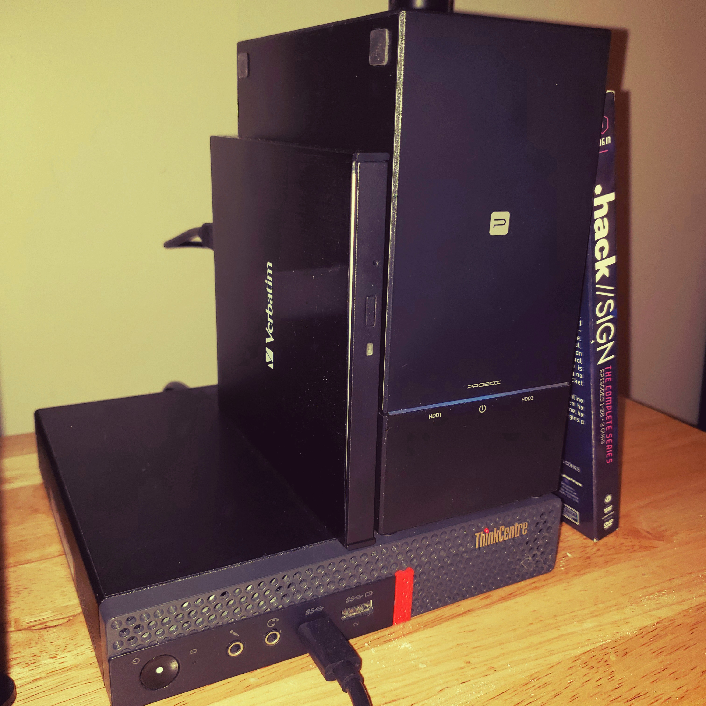

# Intro

## Intro

["Keep Control of Your Computing, So It Doesn't Control You!"](https://www.gnu.org/philosophy/keep-control-of-your-computing.html.en)  
- Richard Stallman (GNU)

A server is just machine or program that manages access to a resource over a network. That network can be entirely local and on one machine, or spread across many machines locally or remotely. 

*You don't need special equipment to start self-hosting*

Typically when people talk about self-hosting, they mention servers. The typical idea is that of a machine that's always-on. That's a convenience. You can: 
1) Use the computer you already have
2) Use a spare device like a laptop or old pc
3) Buy a new computer for it

## My setup

That all said, here's my setup. I knew I wanted to eventually have an always-on machine that operated independtly of my main desktop, something I could experiment on for experience, and something that would ultimately be reachable outside of my local network. Therefore, I bought some additional gear. All you need is compute and storage.

### Hardware

| Component | Specification |
| --- | --- |
| PC | Lenovo ThinkCentre M920q |
| OS | openSUSE Tumbleweed x86_64 |
| BD | Verbatim Slimline |
| HDD | Seage Exos X16 14TB |

### Software

***Zypper Packages***

| Name | Description |
| --- | --- |
| btop | resource monitor |
| docker | containerized applicataion environments |
| docker-compose | define and run containers easily |
| fastfetch | system info for the terminal |
| neovim | based way to edit files in the terminal |
| yazi | rust based terminal file manager |

***Services***

| Name | Description |
| --- | --- |
| Jellyfin | self-hosted media streaming server |
| qBittorrent | torrent client for downloading and managing files |
| Gluetun | VPN container for routing download traffic |
| Homarr | dashboard for accessing and monitoring services |
| Prowlarr | indexer management for the *arr services |
| Sonarr | automated TV series management |
| Radarr | automated movie management |
| Lidarr | automated music library management |
| slskd | web-based Soulseek client |
| RomM | ROM library management and game collection frontend |
| SFTPGo | file server supporting SFTP, FTP, and WebDAV |
| BookOrbit | self-hosted book library management |

***Extra***

| Name | Description |
| --- | --- |
| Tailscale | secure mesh VPN for remote access to devices |

